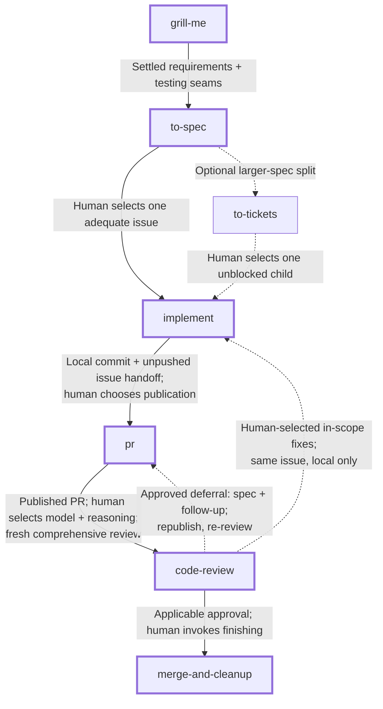

# Personal feature workflow

Quick reference for this fork's [active personal selection](https://github.com/brucepucci/skills/blob/main/enabled-skills.json), from an idea to merge and cleanup. The skill definitions below govern behavior; this page maps the next invocation, not an automated pipeline.

## Choose your entry

| What you have | Where to start |
| --- | --- |
| An idea to sharpen | Invoke `grill-me`. |
| An idea to capture before specifying it | Ask the agent to create a sketch issue as an ordinary request, then invoke `grill-me`. The sketch **needs human specification**. There is no draft-capture skill or draft label here. |
| An existing issue with an adequate [spec](https://www.aihero.dev/ai-coding-dictionary/spec) | Select that issue and invoke `implement` directly. Manually authored issues qualify; `to-spec` is one way to publish settled requirements, not a mandatory producer. |

## Next invocation

**Legend:** solid connections trace the normal route; dashed connections are optional routes. Every connection describes a **possible next action, not automatic invocation**. Choose each handoff deliberately, including every review-fix iteration. Entry states and outcomes are annotations, not extra skills.

**Successful normal finish:** verified merge, safe cleanup of the PR's source branches, completion comments and closeout of fully delivered implementation issues, and return to the safely updated actual default branch. A child finish does not complete its parent or umbrella issue. For a non-default PR target, returning to the default branch does not imply the changes reached it.

## Handoff notes

### Plan together, build one selected issue

Keep `grill-me`, spec synthesis, and any `to-tickets` splitting in one planning [context window](https://www.aihero.dev/ai-coding-dictionary/context-window). Start each `implement` run fresh from the explicitly selected issue and necessary parent requirements. A conversation-only plan or loose spec document cannot replace the issue; an issue record in the configured local tracker qualifies.

- **Single issue:** `implement` validates intended outcomes, acceptance criteria, constraints, and testing decisions. Material gaps need human agreement, authoritative-spec updates, and an explanatory issue comment before work proceeds. It safely creates a feature branch when needed once requirements and testing are settled, without another routine branch-name approval; suitable existing branches are reused.
- **Optional splitting:** `to-tickets` publishes an approved breakdown of a larger spec. The human selects one child whose blockers are complete. Combine shared linked-parent requirements with the child's explicit acceptance criteria, agreed slice, and deferred scope; neither duplicate the parent nor infer scope from code. Repeat the delivery cycle for each selected child, rather than having `implement` select a queue or run them all. Completing children does not automatically close the parent.
- **Local boundary:** `implement` implements and verifies, rechecks requirements, commits locally, and records an explicitly unpushed issue handoff. It leaves the issue open. It does not push, create or update a PR, invoke review, or merge.

### Publish, then request review separately

Invoke `pr` when prepared work is ready to publish. It verifies the intended candidate and publishes it, creating or updating the matching PR with authoritative requirements and honest evidence. It stops at the manual review handoff. A request to fix findings, or discovery of an existing PR, grants no publication authority. Explicit preview, body-only, and local-only requests retain their limits.

Choose the review [model](https://www.aihero.dev/ai-coding-dictionary/model) and reasoning level, open a fresh [session](https://www.aihero.dev/ai-coding-dictionary/session), then request `code-review comprehensive <PR URL>` against the published PR. Comprehensive review covers Standards, Spec, and Correctness. Review is read-only: it reports findings and a recommendation, not fixes or merge authorization.

### Review fixes or deferred scope

| What the review exposes | Deliberate next actions |
| --- | --- |
| Human-selected, in-scope fixes | Invoke `implement` on the **same selected issue**, reuse its suitable feature branch, and stop at a local commit and issue handoff. No new issue is required for every finding. Separately invoke `pr` to republish, then separately request fresh comprehensive `code-review` on the published head. |
| Genuinely new work outside current requirements | Decide whether it is wanted. Ask the agent to capture wanted work in a linked follow-up issue as an ordinary request; it is not automatically a blocker in the current scope. |
| An unmet current requirement proposed for deferral | Obtain explicit human agreement to change scope. Ask the agent to update the **authoritative requirements**, including the parent source when applicable, record why, and capture still-wanted work in a linked follow-up issue. Reconcile the current delivery and PR scope before republishing and re-reviewing. |

A follow-up issue alone does **not** satisfy or remove an unmet requirement. Until scope is explicitly reconciled, the current PR remains incomplete. Requirement edits and follow-up capture are ordinary agent requests, not a scope-deferral skill or a claim that `to-spec` updates existing issues. If deferral leaves implementation changes to make, return through `implement` before `pr`. Current approval must cover the reconciled head and requirements; old evidence does not automatically apply after material changes.

### Finish deliberately, report the actual state

Invoke `merge-and-cleanup` separately after review. Its normal path needs applicable comprehensive approval for the current head and requirements, with no unresolved blockers, or an explicit head-scoped override of disclosed review shortcomings allowed by the skill. An override does not waive GitHub checks or protections and does not settle unresolved implementation-issue delivery.

| State | What the finish means |
| --- | --- |
| Ready and fully delivered | Squash-merge, verify the remote merge, safely clean up only the PR's source branches, complete clearly identified fully delivered implementation issues, and return to the safely updated actual default branch. Parent/umbrella references alone are not completed deliverables. |
| Blocked before merge | Missing prerequisites, unclear issue delivery, or unsafe local state leave the PR unmerged and preserve work. Resolve the reported blocker, then explicitly choose the next attempt. |
| Merged, but cleanup or closeout is partial | Preserve unsafe or uncertain work. Report the verified merge separately from retained branches, incomplete issue actions, checkout state, and safe next actions. Independently safe authorized steps may proceed; partial completion is not full success. |
| PR targets a non-default branch | Name that actual target and its delivered scope. Default-branch checkout/update is housekeeping, not evidence of delivery there. |

## Skill reference

Read the current definitions for full prerequisites and safety rules:

- [grill-me](https://github.com/brucepucci/skills/blob/main/skills/productivity/grill-me/SKILL.md)
- [to-spec](https://github.com/brucepucci/skills/blob/main/skills/engineering/to-spec/SKILL.md)
- [to-tickets](https://github.com/brucepucci/skills/blob/main/skills/engineering/to-tickets/SKILL.md)
- [implement](https://github.com/brucepucci/skills/blob/main/skills/engineering/implement/SKILL.md)
- [pr](https://github.com/brucepucci/skills/blob/main/skills/engineering/pr/SKILL.md)
- [code-review](https://github.com/brucepucci/skills/blob/main/skills/engineering/code-review/SKILL.md)
- [merge-and-cleanup](https://github.com/brucepucci/skills/blob/main/skills/engineering/merge-and-cleanup/SKILL.md)

For routes outside this feature reference, use [ask-matt](https://github.com/brucepucci/skills/blob/main/skills/engineering/ask-matt/SKILL.md). Configure the target repository's tracker through [setup-matt-pocock-skills](https://github.com/brucepucci/skills/blob/main/skills/engineering/setup-matt-pocock-skills/SKILL.md) before tracker-dependent work; always verify the destination, especially in a fork.
