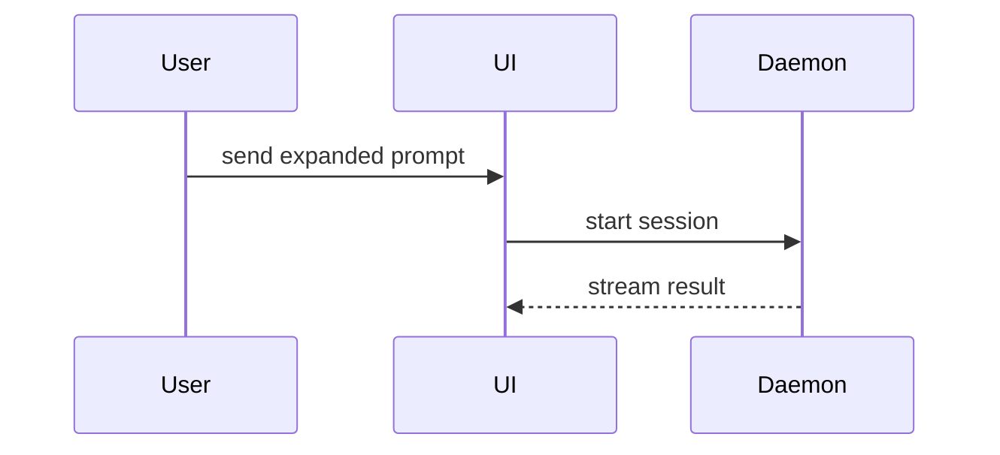

# PR description

Keep prose brief, skip preambles, and use domain vocabulary. Requirements come before the explanation of the diff.

```markdown
## Spec

<authoritative issue link, or approved inline requirements>
<for a partial delivery: agreed slice and deferred requirements>

## Implementation

<optional: smallest useful explanation, diagram, diff sketch, or tree>

## Evidence

- **Candidate tree:** `<Git tree OID>` (matching committed/pushed contents)
- `<actual command>`: <actual result>
- <failures, unavailable/unrun checks, limitations, and any authorized draft exception>
- <genuine before/after evidence when available; otherwise disclose the missing baseline>

## Merge Danger

**Door:** <one-way or two-way>
<why, if not obvious>

**Blast Radius:** <scope of potential impact>
<potential ramifications, if useful>
```

## Spec

An issue link keeps the requirements in one authoritative home. Inline requirements describe intended behavior and verifiable acceptance criteria, with constraints and exclusions as applicable. Keep detail proportional; a small change does not need an extensive story template. An agreed partial slice belongs beside the link, not hidden in the implementation narrative.

## Implementation, optional

Pick the **smallest view** that makes the key point clear. Omit the section when it adds nothing. Place each visual beside the short text it supports. Keep only the calls, files, props, states, and boundaries the reviewer needs. Usually one view is enough; avoid a gallery.

- Logic or an algorithm: pseudocode.
- Runtime control flow: a call tree.
- UI structure: a component tree with meaningful state/module boundaries.
- File responsibilities or a broad refactor: a shallow file tree.
- Component interaction or data flow: Mermaid.
- A change whose surrounding shape is familiar: a shaped diff.

For logic:

```text
on(save)
  if content is unchanged
    return cached result
  write new content
  return fresh result
```

For runtime flow:

```text
submitForm
  createSession
    persistPrompt
    launchAgent
  navigateToSession
```

For UI or file layout, show only relevant structure:

```text
<SessionPage>
  useSessionEvents()
  <SessionToolbar>
    <RunSkillButton />
```

```text
src/
├── commands/       # parses user actions
├── sessions/       # owns session state
└── transport/      # sends API requests
```

For interaction:



Shape a diff around the component, file layout, call tree, or state transition, not necessarily raw source:

```diff
 on(save)
-  write content
+  if content is unchanged
+    return cached result
+  write content
+  invalidate cache
```

Show a whole block instead when most of it is new, omitted context would hide ownership/order, or the reviewer needs a copyable target shape.

## Evidence

Identify the candidate tree OID and the isolated verification environment. Record the pinned published commit/head once confirmed remotely, so evidence and follow-up links identify the actual delivery. Results apply only to that tree; changed contents need fresh checks. An authorized draft exception identifies the candidate but explicitly marks its verification incomplete. Prefer actual execution output. Use screenshots for visual changes when the environment supports them. Show exact commands and results, not invented tests or pseudocode presented as execution. Before/after evidence is valuable only when both were actually captured; otherwise say that no before-change evidence was collected. State failures and coverage limits alongside successful checks.

## Merge Danger

A **two-way door** is cheap to roll back. A **one-way door** involves destructive actions or hard-to-reverse decisions: rolling back code may not undo a migration or unsend messages. Assess reversibility, not just ease of reverting a commit.

**Blast radius** is the potential scope of impact: API consumers, persisted data, layout, mobile responsiveness, or other affected users and systems. Make the risk assessable rather than assuming a small diff means low risk.
